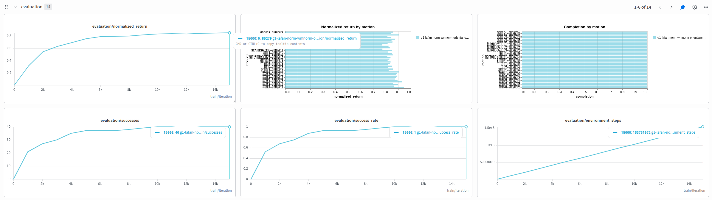

# SuperMimic Mjlab

[English](README.md) | 简体中文

<p align="center">
  
</p>

面向 Unitree G1 多动作跟踪的 [SuperMimic](doc/supermimic.pdf) 复现。当前策略采集
真实仿真转移，世界模型用 8 步自回归窗口学习动力学，再通过 32 步可微想象训练
Actor 和 Critic。

当前数据集包含 40 段 G1 重定向 LAFAN 动作，约 2.45 小时，控制频率为 50 Hz。

完整规模训练使用单张 **NVIDIA RTX A6000（48 GB 显存）**，在 4096 环境、FP32
配置下训练 **15000 轮约需 4 小时**。显存较小的 GPU 可通过减少环境数和 batch size
缩小训练规模，具体配置见[训练操作指南](doc/training_and_playback_zh.md#缩小训练规模)，性能未经验证。

<p align="center">
  
</p>

最佳模型在全部 40 段 LAFAN 动作的固定起点、完整动作标准评估中取得 **40/40
成功动作（100%）**、**100% 平均完成率**和 **0.8528 归一化回报**。
配置对比与权重使用方法见[消融结果与发布模型](#消融结果与发布模型)。

机器人使用本地复制的 [RoboJuDo-Plus G1 资源](src/assets/robots/g1/README.md)，
加载 `g1_29dof_rev_1_0.xml`，碰撞体包含网格、肩部圆柱体及每脚 4 个半径 5 mm 的
球体。训练沿用 mjlab 的 PD 控制配置，关闭自碰撞。

## 运行环境

在仓库根目录安装并激活环境：

```bash
uv sync
source .venv/bin/activate
```

依赖和 GPU 检查见[安装说明](doc/setup_zh.md)。

## 代码结构

按职责划分配置、数据、任务函数、模型与训练代码：

```text
src/tasks/supermimic/
├── config/
│   ├── task_cfg.py           # G1 状态维度、动作库路径和环境运行参数
│   └── rl_cfg.py             # OnlineConfig：训练规模、网络宽度与优化参数
├── data/
│   ├── motion_library.py     # NPZ 动作库、参考帧与未来窗口
│   ├── replay_buffer.py      # 带 episode 边界的回放与历史重建
│   └── world_model_data.py   # 离线数据划分、去重与 ReplayCorpus
├── mdp/
│   ├── state.py              # 状态布局、四元数运算、观测与传感器噪声
│   ├── rewards.py            # 可微跟踪奖励
│   ├── terminations.py       # 物理失败判定
│   └── reset_sampler.py      # 按回报分配重置起点
├── models/
│   ├── kinematics.py         # 可微 G1 运动学与机器人元数据
│   ├── world_model.py        # 动力学及任务预测头
│   └── policy.py             # MotionActor、MotionCritic 与参考特征
├── rl/
│   ├── imagination.py        # BPTT、软生存权重、GAE 与 Critic 损失
│   ├── online_training.py    # 采集、世界模型拟合、Actor–Critic 更新
│   ├── training_logger.py    # 终端表格和 W&B 日志
│   ├── checkpoints.py        # 完整断点与轻量策略导出
│   ├── world_model_training.py # 独立世界模型训练与验证
│   └── evaluation.py         # 固定起点完整动作评估
├── env.py                    # SuperMimicEnv：真实仿真接口
└── env_cfg.py                # mjlab 场景、PD 动作与域随机化
```

各子包的 `__init__.py` 保持轻量，回归测试位于 `tests/`。脚本按使用频率和用途组织：

```text
scripts/
├── train_supermimic.py            # 在线联合训练
├── evaluate_supermimic.py         # checkpoint 策略评估
├── play_supermimic.py             # MuJoCo 实时策略／参考对照
├── export_supermimic_policy.py    # 从完整断点提取策略或世界模型
├── data/
│   └── convert_lafan_to_npz.py     # LAFAN CSV 转 NPZ
└── offline/
    ├── collect_supermimic.py      # 采集快照或运动学回放校验
    └── train_world_model.py       # 独立世界模型训练与验证
```

日常在线训练、评估和播放使用根目录脚本。`offline/` 用于诊断和离线实验，
在线训练不需要先运行这些脚本。

## 准备动作数据

原始 CSV 位于 `src/assets/motions/LAFAN1_Retargeting_Dataset/`。尚未转换时运行：

```bash
python scripts/data/convert_lafan_to_npz.py \
  --input-dir src/assets/motions/LAFAN1_Retargeting_Dataset \
  --output-dir src/assets/motions/g1/lafan1_npz \
  --input-fps 30 --output-fps 50
```

输出为每段动作的 NPZ 和 `manifest.json`，已有转换结果时可跳过。
字段和坐标约定见 [LAFAN 转换说明](doc/lafan_conversion_zh.md)。

## 在线训练

`motion_anchor_ori_b` 是可选消融变量，默认关闭，可在训练命令中添加
`--motion-anchor-ori-b` 开启。

### 消融结果与发布模型

消融实验统一使用 `full_body_268` 参考特征、FP32 网络、4096 个环境，并在全部 40
段 LAFAN 动作上进行完整确定性评估。下表是各配置已完成重跑在第 15000 轮的均值：

| 配置 | 成功动作 | 归一化回报 |
| --- | ---: | ---: |
| Actor／Critic 输入归一化 | 38-40/40 | 0.6016 |
| + torso 坐标系动作朝向 anchor | 38–40/40 | 0.8130 |
| + 世界模型归一化 | 40/40 | 0.8504 |
| + 修正后的 15000 轮余弦学习率 | **40/40** | **0.8526** |

朝向 anchor 带来了最大的策略性能提升，世界模型归一化则是保证其稳定训练的关键；
收益主要集中在 walk 动作，部分 get-up、jump 和 run 动作仍有取舍。

| 文件 | 内容 |
| --- | --- |
| `checkpoints/best/policy.pt` | 第 15000 轮最佳 Actor 权重，用于真实物理播放 |
| `checkpoints/best/world_model.pt` | 同轮配套世界模型，用于叠加预测姿态 |

选中策略在完整标准评估中取得 **40/40 成功动作**、**1.0 平均完成率**和
**0.8528 归一化回报**。

训练硬件为单张 **NVIDIA RTX A6000（48 GB 显存）**。使用下述 4096 环境、FP32
配置，完成 **15000 轮训练约需 4 小时**。

在仓库根目录运行以下配置可复现所选训练设置：

```bash
python scripts/train_supermimic.py \
  --device cuda:0 \
  --reference-dim 2680 \
  --world-prediction state_delta \
  --actor-input-normalization --critic-input-normalization \
  --world-model-normalization --motion-anchor-ori-b \
  --amp none --no-compile \
  --seed 0 \
  --num-envs 4096 --capacity 1000 \
  --warmup-steps 32 --wm-only-iters 0 \
  --collect-steps 5 --updates-per-collect 2 \
  --wm-batches 10 --wm-batch-size 2048 \
  --policy-batch-size 4096 --horizon 32 \
  --critic-epochs 5 --critic-minibatches 4 \
  --learning-rate 2e-4 \
  --world-dims 2048 2048 2048 \
  --actor-dims 2048 1024 512 256 \
  --critic-dims 256 128 \
  --iterations 15000 \
  --eval-interval 1000 --checkpoint-interval 1000 \
  --output outputs/supermimic/run
```

训练器按照成功动作数优先、归一化回报次优的规则，配套输出 `policy_best.pt` 和
`world_model_best.pt`。

在真实物理中播放指定动作：

```bash
python scripts/play_supermimic.py \
  --device cuda:0 --checkpoint checkpoints/best/policy.pt \
  --clips walk1_subject1 run1_subject2 --loop
```

同时预览世界模型内策略在未来 32 个控制步（0.64 秒）后的预测：

```bash
python scripts/play_supermimic.py \
  --device cuda:0 --checkpoint checkpoints/best/policy.pt \
  --world-model checkpoints/best/world_model.pt \
  --world-model-mode future --world-model-horizon 32 \
  --clips walk1_subject1 run1_subject2 --loop
```

不指定 `--clips` 时播放全部 40 段动作。播放默认允许鼠标外力，并在超过高度／倾斜
阈值后继续执行；加 `--no-perturbations --termination` 可关闭交互外力并恢复失败重置。
全部动作的标准无窗口评估命令：

```bash
python scripts/evaluate_supermimic.py \
  --device cuda:0 --checkpoint checkpoints/best/policy.pt \
  --output outputs/supermimic/evaluation_best.json
```

训练默认启用域随机化、观测噪声和按回报采样的重置；不指定 `--clips` 时使用全部
动作，调试可指定 `--clips walk1_subject1 run1_subject2`。

机器人关闭自碰撞，保留全身触地。训练重置扰动参考位姿、根速度和关节位置；摩擦与
躯干质心在启动时采样，编码器偏差逐 episode 重采样。评估关闭重置噪声和域随机化。
范围见[环境配置](doc/supermimic_foundation_zh.md)。训练变体、可选 RunningNorm、
checkpoint 格式和查看器操作见[操作指南](doc/training_and_playback_zh.md)。

### 断点恢复

网络和 batch 设置从完整 checkpoint 恢复；`--iterations` 为包含已完成轮数的总轮数：

```bash
python scripts/train_supermimic.py \
  --device cuda:0 --resume outputs/supermimic/run/last.pt \
  --iterations 32000
```

## 训练日志与 W&B

终端按输出区间统计平均值；`Fail%` 为每条采集转移对应的物理失败事件频率，
`Steps/s` 包含采集和优化时间，`GPU` 为 PyTorch 分配器记录的显存峰值（GiB）。
仿真初始化、kernel 和 seed 信息写入 `simulator.log`，异常回溯保留在 stderr。

`--log-interval 50` 可降低输出频率，`--verbose-sim` 显示仿真详情，
`--log-format json` 切换 JSON 输出。`metrics.jsonl` 始终逐轮保存原始指标；
安装 `rich` 时使用格式化表格，否则使用普通文本。

安装可选依赖并登录一次：

```bash
uv sync --extra logging
wandb login
```

为新训练启用 W&B：

```bash
python scripts/train_supermimic.py \
  --device cuda:0 --iterations 1000 \
  --wandb --wandb-project supermimic --wandb-name g1-lafan \
  --output outputs/supermimic/online_wandb
```

续训时再次传入 `--wandb`。离线日志和 run 延续规则见
[操作指南](doc/training_and_playback_zh.md#训练日志与-wb)。

## 详细文档

- [安装说明](doc/setup_zh.md)
- [训练变体、checkpoint 格式、评估、查看器操作与测试](doc/training_and_playback_zh.md)（[English](doc/training_and_playback_en.md)）
- [LAFAN 数据转换](doc/lafan_conversion_zh.md)
- [动作库、采集环境与 Replay Buffer](doc/supermimic_foundation_zh.md)
- [独立世界模型训练与验证](doc/supermimic_world_model_zh.md)
- [在线训练与评估协议](doc/supermimic_online_zh.md)

独立采集和模型训练入口用于诊断及离线实验，在线训练可以直接从头开始。
